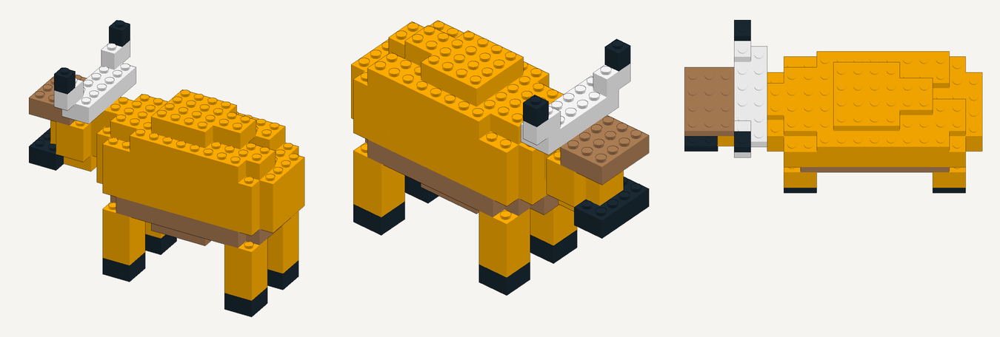

# LEGO Remake

**Build new LEGO models from the parts of a set you already own.**

You describe an animal (or anything) as a rough 3D shape. The generator then works out how to build it using *only* the bricks in one LEGO set, and writes:

- an LDraw model (`.ldr`) you can open in [LeoCAD](https://www.leocad.org) or [BrickLink Studio](https://www.bricklink.com/v3/studio/download.page)
- a picture of the model
- step-by-step build instructions with a parts list

It can also build **several models from one box**, so they don't fight over the same bricks.

**See the examples:** [the example gallery](docs/index.html) (also published as this repository's GitHub Pages site).



## Examples

| Model | Built from | Pieces | Files |
|---|---|---|---|
| Highland cow, Holstein cow, long-neck dinosaur, potbelly pig: **all four from one box** | 11045 Creative Colorful Bricks | 113 + 125 + 78 + 88 = 404 of the box's 820 | [11045-animals](docs/examples/11045-animals/) |
| Turtle | 71426 Piranha Plant | 87 | [turtle-71426](docs/examples/turtle-71426/) |
| Penguin | 21349 Tuxedo Cat | 292 | [penguin-21349](docs/examples/penguin-21349/) |

Each example folder has the `.ldr` model, a render, and an `*-instructions/instructions.html` page you can open in a browser or print.

## Setup

You need Python 3.10 or newer.

```
pip install -r requirements.txt
python get_data.py
```

`get_data.py` downloads two free resources once (about 100 MB):

- [Rebrickable's database downloads](https://rebrickable.com/downloads/): what parts every LEGO set contains. Saved to `data/`.
- The [LDraw parts library](https://library.ldraw.org): the 3D shape of every LEGO part. Saved to `ldraw/`.

For step-by-step instructions, also install [LeoCAD](https://www.leocad.org) (free). If it isn't found automatically, set the `LEOCAD` environment variable to its path.

## Make a model

```
python make_model.py 11045-1 shapes/highland.py out/highland.ldr --scale 0.7 --bricks-only --render --instructions
```

- `11045-1`: the set to build from (its [Rebrickable](https://rebrickable.com) set number).
- `shapes/highland.py`: what to build (see below).
- `--scale`: how big. Bigger uses more pieces. Try 0.6 to 1.0.
- `--bricks-only`: for sets that are mostly bricks with few plates, such as the 11045 Classic box.
- `--render` and `--instructions`: also save a picture and build instructions next to the model.

It tries several random seeds (`--seeds 1-6`) and keeps the cleanest result. The summary lists every seed: how many pieces it used, how many loose pieces it had to remove, how many cells it couldn't fill, and how many pieces are the wrong colour. All four should be as low as possible.

### Several models from one box

Build the models one at a time. Pass the earlier ones with `--after`, so each new model only gets the bricks that are left. This rebuilds the 11045 animals exactly:

```
python make_model.py 11045-1 shapes/highland.py out/highland.ldr --scale 0.7 --bricks-only --seeds 1-6
python make_model.py 11045-1 shapes/holstein.py out/holstein.ldr --scale 0.7 --bricks-only --seeds 1-6 --colmap 19=84 --var MUZZLE=84 --after out/highland.ldr
python make_model.py 11045-1 shapes/sauropod.py out/longneck.ldr --scale 0.85 --bricks-only --seeds 1-4 --after out/highland.ldr out/holstein.ldr
python make_model.py 11045-1 shapes/pig.py out/pig.ldr --scale 0.9 --bricks-only --seeds 1-6 --after out/highland.ldr out/holstein.ldr out/longneck.ldr
```

Order matters: models built earlier get first pick of the bricks.

### Other options

- `--var KEY=VALUE`: shape settings, such as colours. The top of each shape file lists them. Example: `--var COAT=84` makes a fawn Highland.
- `--colmap 19=84`: use a colour the set has (84, Medium Nougat) in place of one it lacks (19, Tan).
- `--add 3024:5:20,11477:5:6`: extra loose parts (`PART:COLOUR:QTY`), for example from LEGO Pick a Brick.

Colours are [Rebrickable colour ids](https://rebrickable.com/colors/): 0 black, 15 white, 4 red, 5 dark pink, 27 lime, 84 medium nougat, 191 bright light orange, and so on.

## Find a set for a shape

```
python generator/find_sets.py shape shapes/pig.py --minyear 2024 --top 20
```

This ranks LEGO sets by whether their parts can cover the shape in the right colours.

## Write your own shape

A shape file is a short Python file. Each one sets four things on a grid of cells (1 stud wide, 1 plate tall):

- `solid`: which cells are filled.
- `col`: each cell's colour.
- `KEYC`: the colours that matter most.
- `TITLE`: the model's name.

Helpers make the shapes:

- `ell(centre, radii)` for a ball.
- `sell(centre, radii, p)` for a rounded box.
- `box(lo, hi)` for a box.
- `studs(n)` and `snap(v)` to line features up with whole studs.

Units are LDraw units before scaling: 20 = one stud, 8 = one plate. The front is −Z and Y points up. Copy [shapes/pig.py](shapes/pig.py) to get started.

Tips from building these:
- Features thinner than about 2 studs tend to disappear.
- For brick-only sets, make features whole bricks tall: `B = 24 / SC` is one brick in shape units.
- Anything that has to stay attached, like ears, horns or eyes, needs bricks above or below it to click into. Otherwise the generator removes it as a loose piece.

## How it works

The generator turns the shape into a grid of cells and fills it layer by layer, from the bottom up. On each layer it places curved and sloped pieces first, then bricks and plates. It prefers pieces that bridge over the layer below, so the model holds together. It leaves the inside hollow and fills any gaps with hidden spare pieces. Finally it keeps only the largest connected group of pieces, swaps colours so the visible pieces are right, and writes one build step per layer.

Code is in [generator/](generator/):

| File | Job |
|---|---|
| `generate.py` | the builder |
| `partshape.py` | measures each part's 3D shape |
| `shapelib.py` | loads shape files |
| `render.py` | pictures |
| `instructions.py` | build instructions |
| `find_sets.py` | set search |

## Known limits

- **Parts:** it only uses plain bricks, plates, tiles, and curved or sloped bricks. Technic, hinges, round bricks and similar special parts are skipped.
- **Colours:** the `.ldr` files use Rebrickable colour ids as LDraw colour codes. These match for common colours but not all of them.
- **Old examples:** the penguin was made with an earlier, plates-only version of the generator that isn't included here.
- **Speed:** a model takes about a minute per seed, and the seeds run in parallel.

## Credits

The idea, direction and models are by **Hays Dixon**. The code, shapes and instructions were written by **Claude Opus 5.5** (Anthropic), working from his ideas and feedback.

- Set inventories come from [Rebrickable](https://rebrickable.com).
- Part geometry comes from the [LDraw](https://www.ldraw.org) parts library. Both are downloaded under their own terms and aren't included in this repository.

LEGO® is a trademark of the LEGO Group, which does not sponsor, authorize or endorse this project.

## License

[MIT](LICENSE)
